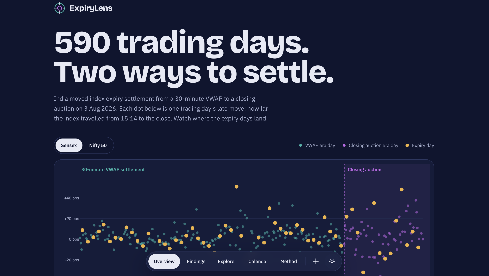
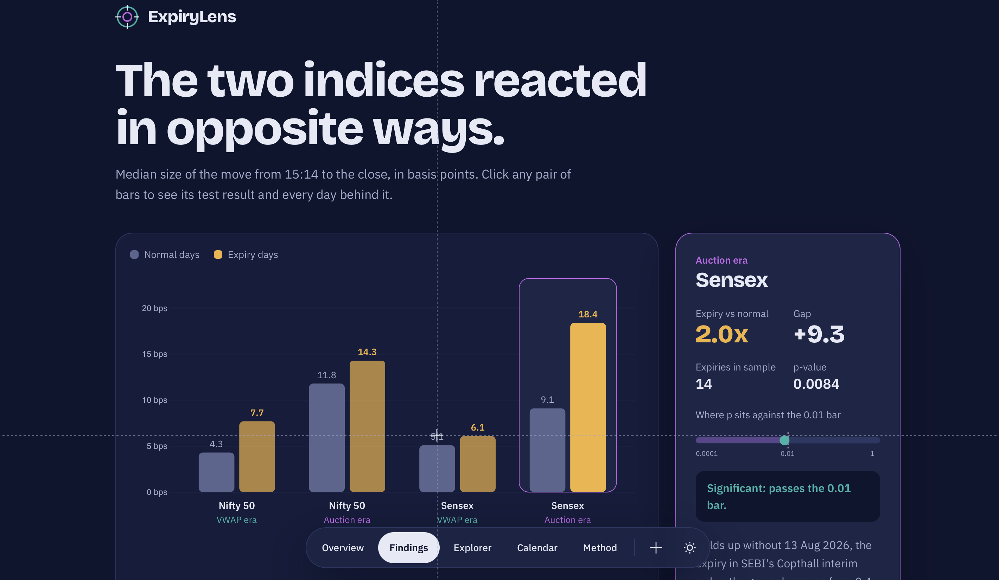
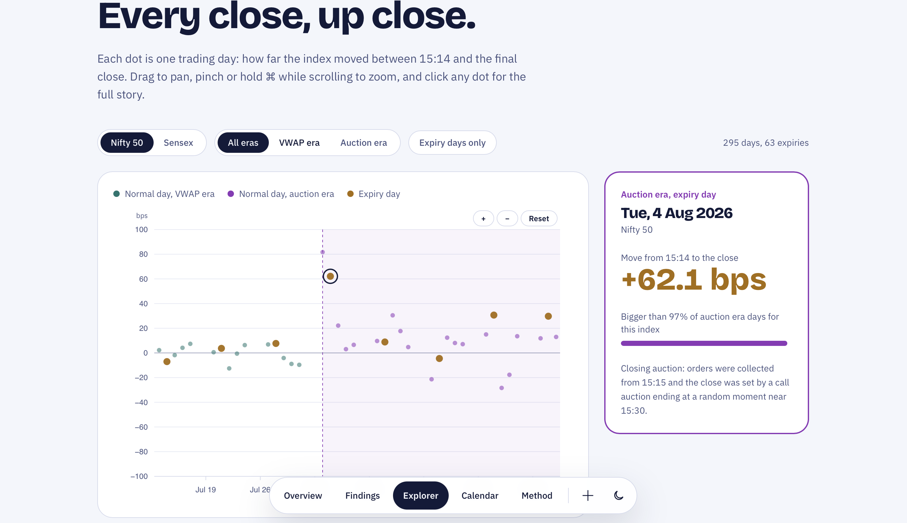
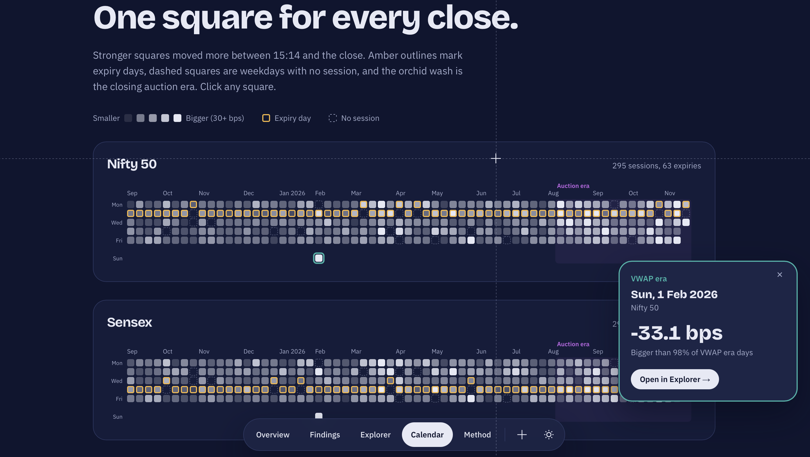
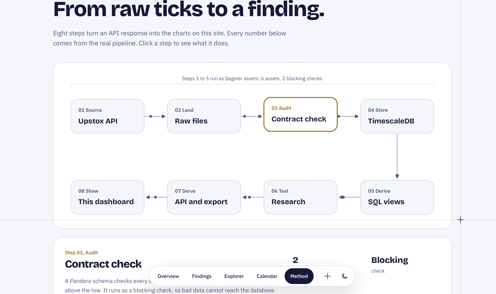
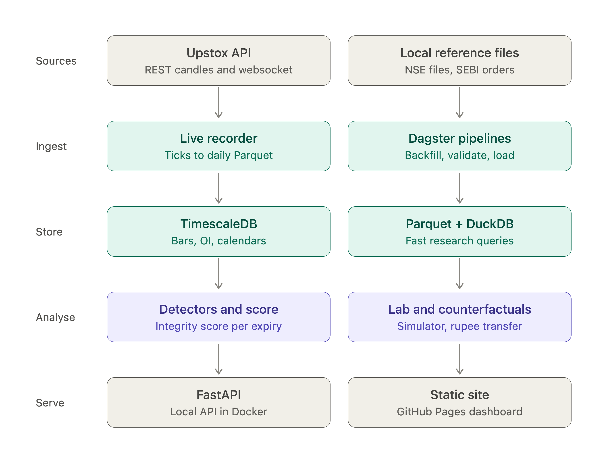
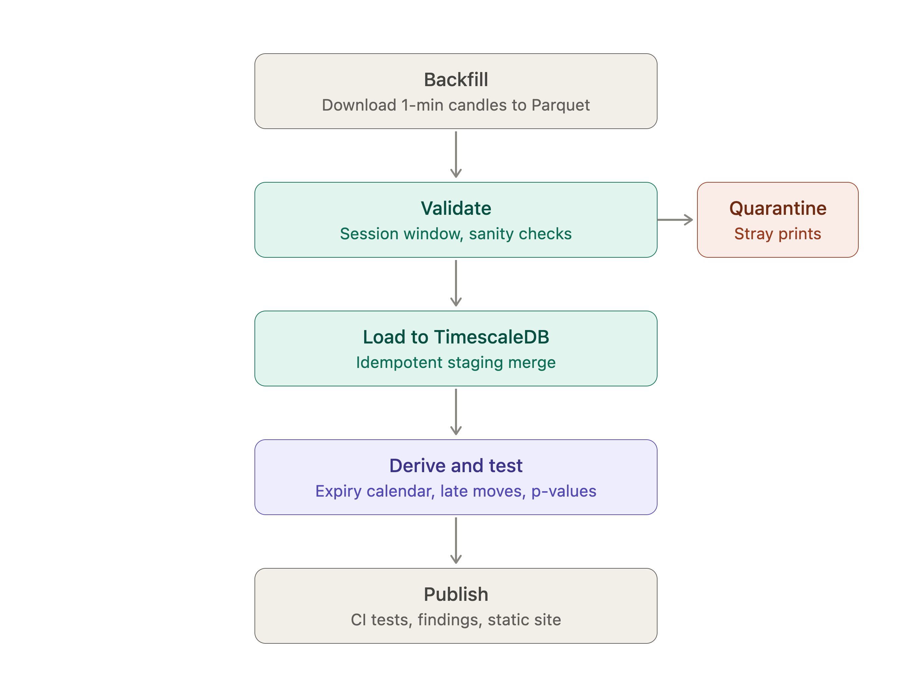

# ExpiryLens

[](https://github.com/dhiraj-tapkir/expirylens/actions/workflows/tests.yml)
[](https://github.com/dhiraj-tapkir/expirylens/actions/workflows/pages.yml)

Measuring how India's index expiry-day closes behave, and how that changed when
settlement moved from a 30-minute VWAP to a closing auction in August 2026.
Built only on public market data.

**Live dashboard: [dhiraj-tapkir.github.io/expirylens](https://dhiraj-tapkir.github.io/expirylens/)**



## Key findings so far

Late move = how far the index moves from the 15:14 candle (the last minute
before the closing auction freezes the index) to the day's final close.
Median absolute late move, in basis points:

| Index | Settlement regime | Normal days | Expiry days | Gap | p-value |
|---|---|---|---|---|---|
| Nifty 50 | VWAP (Sep 2025 to Jul 2026) | 4.3 | 7.7 | +3.3 | 0.0012 |
| Nifty 50 | Closing auction (Aug to Nov 2026) | 11.8 | 14.3 | +2.5 | 0.27 |
| Sensex | VWAP (Sep 2025 to Jul 2026) | 5.1 | 6.1 | +0.9 | 0.18 |
| Sensex | Closing auction (Aug to Nov 2026) | 9.1 | 18.4 | +9.4 | 0.0084 |

p-values come from permutation tests (10,000 shuffles, fixed seed). With five
tests the bar is p < 0.01.

- **Nifty** shows a clear expiry effect under VWAP settlement. After the auction
  started the gap looks smaller, but that test is too small to tell.
- **Sensex** shows no clear effect before and a gap roughly double after, though
  that result is borderline (see the checks below).
- Leaving out 13 Aug 2026, the Sensex expiry in SEBI's Copthall interim order,
  barely moves the Sensex result (9.4 to 8.9 bps). One day is not driving it.
- The auction had a rough start. Nifty's first auction-era expiry (4 Aug 2026)
  moved +62.1 bps after 15:14, bigger than 97% of auction-era days. Without
  the first week the Sensex gap holds (8.9 bps) but p rises to 0.019, so that
  result is suggestive but fragile.
- Dropping Budget day and RBI policy days changes little. The Nifty VWAP-era
  result gets stronger (p 0.0003), making it the most robust finding so far.
- A power check (ExpiryLab, step one) shows why the auction era is hard to
  call: with 14 to 15 expiries the test reliably catches only effects of about
  12 bps or more, against about 4 bps with 48 VWAP-era expiries. The Nifty
  auction-era null is inconclusive, not proof the effect vanished.
- In the ExpiryLab simulator, a manipulator pushing VWAP settlement from 15:00
  moves it about 5 bps yet stays invisible to the late-move test, which only
  sees moves after 15:14. A signed test catches late pushes far better than
  the size test used so far.
- On the real data, the signed test finds no one-directional push in any
  index or era. Sensex auction-era expiry moves are bigger, but go both ways.
- During the closing auction the displayed index freezes from 15:15 to about
  15:28, then jumps once. Any "last 30 minutes" metric has to account for this.

These are statistical patterns, not evidence of manipulation. Hedging flows
and differences between the two exchanges' auctions could explain them.
Full notes, dates and open questions: [docs/findings.md](docs/findings.md).

## The dashboard

Five pages, every chart clickable, night and day themes, and links that open
straight onto a specific day
([try one](https://dhiraj-tapkir.github.io/expirylens/explorer/?index=NIFTY&day=2026-08-04)).

| | |
|---|---|
|  |  |
| **Findings:** the four tests, with every day behind each one | **Explorer:** zoom and pan through every close, TradingView-style crosshair |
|  |  |
| **Calendar:** one square per session, Budget Sunday included | **Method:** the pipeline, step by step, with real numbers |

## What's built

- **Ingestion:** a small Upstox client that pulls 1-minute candles a month at a
  time, saves them as Parquet, and loads them into TimescaleDB through a
  staging table. Re-running it never creates duplicates.
- **Data contracts:** a Pandera schema checks every candle (unique timestamps,
  positive prices, a high above the low) as a blocking check, so bad data never
  reaches the database.
- **Data quality:** out-of-session prints on normal days go to a quarantine
  table with a reason, instead of being loaded or deleted. Every row is
  accounted for (rows read = inserted + quarantined).
- **Orchestration:** Dagster runs the pipeline as 6 assets with 2 blocking
  checks, from raw candles to the derived views.
- **Expiry calendar:** derived in SQL from the days that actually traded, so
  holidays shift expiries automatically. Weeks the data doesn't fully cover yet
  are skipped.
- **Research:** a late-move view, permutation tests per index and regime, and
  leave-one-out, burn-in and event-day robustness checks, a power check, and
  ExpiryLab, a calibrated simulator with a planted manipulator.
- **API:** a read-only FastAPI service with validated, parameterised queries.
- **Dashboard:** a static Next.js site with D3 charts, built from exported
  results and deployed to GitHub Pages on every merge.
- **Tests:** 25 in total (unit, contract, API and data tests). The data tests
  need the local database, so CI runs the other 15 on every push.

| | |
|---|---|
| Candles | 221,510 (Nifty 50 and Sensex, Sep 2025 to Nov 2026) |
| Trading days | 297 per index, including 2 Muhurat sessions |
| Expiries | 125 (63 Nifty, 62 Sensex) |
| Quarantined prints | 2 |
| TimescaleDB chunks | 63 weekly chunks |
| Tests | 25 |

## Architecture



## Data workflow



## Run it yourself

You need Docker, [uv](https://docs.astral.sh/uv/), Node.js, and a free Upstox
account for an Analytics (read-only) token.

```bash
git clone https://github.com/dhiraj-tapkir/expirylens.git
cd expirylens
uv sync

# secrets live in .env, which git ignores
echo "POSTGRES_PASSWORD=$(openssl rand -hex 16)" > .env
echo "UPSTOX_ACCESS_TOKEN=<your analytics token>" >> .env

# database
docker compose up -d
docker exec -i expirylens-db psql -U expiry -d expirylens < infra/sql/001_init.sql

# pipeline: open http://localhost:3000 and materialize all assets
uv run dagster dev -m pipelines.definitions

# tests and statistics
uv run pytest -v
uv run python -m research.late_move_test

# API docs at http://localhost:8000/docs
uv run uvicorn api.main:app --reload

# dashboard at http://localhost:3000/expirylens/
uv run python -m pipelines.export_site_data
npm --prefix web ci
npm --prefix web run dev
```

## Repo layout

| Folder | What's in it |
|---|---|
| `pipelines/` | Upstox client, backfill, loader with quarantine, contracts, Dagster assets, site export |
| `infra/sql/` | Schema, expiry calendar, late-move view |
| `research/` | Statistical tests |
| `api/` | Read-only FastAPI service |
| `web/` | Next.js and D3 dashboard |
| `tests/` | Unit, contract, API and data tests |
| `docs/` | Findings log, diagrams and screenshots |
| `.github/workflows/` | Test runs and the GitHub Pages deploy |

## Limitations

- 1-minute candles can't show what happens inside the closing auction.
- The last candle of the day is used as the close. Official settlement values
  are not in yet.
- Only 14 to 15 closing-auction expiries per index so far, so the auction-era
  results carry wide uncertainty.
- Event days (Budget day, RBI policy days) stay in the main tests and are
  only dropped in a separate robustness check.
- Holidays are inferred from missing trading days and still need checking
  against NSE's official list.
- SEBI's orders referenced here are interim, not final findings.

## Roadmap

- Official settlement values and Bank Nifty
- Closing-auction depth per exchange, to test why Nifty and Sensex differ
- Build a detector for pushes that start before 15:14, and check whether the
  auction-era upward drift on normal days is real
- Counterfactual settlement and rupee-transfer estimates
- Re-run everything once expiries settle on the 30-minute VWAP again (from
  7 Dec 2026)

## Data note

Market data comes from the Upstox API and stays local. Only code and derived
results are published here. This is independent research for learning, not
investment advice.
