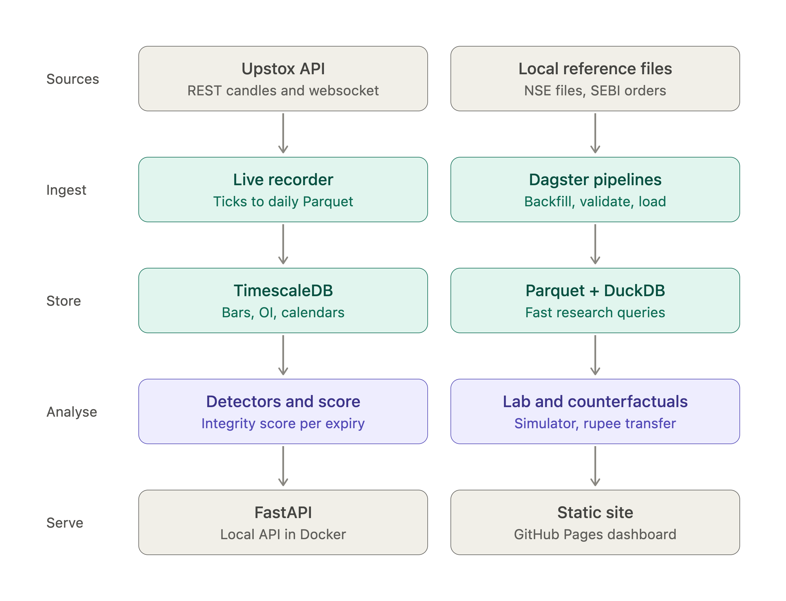
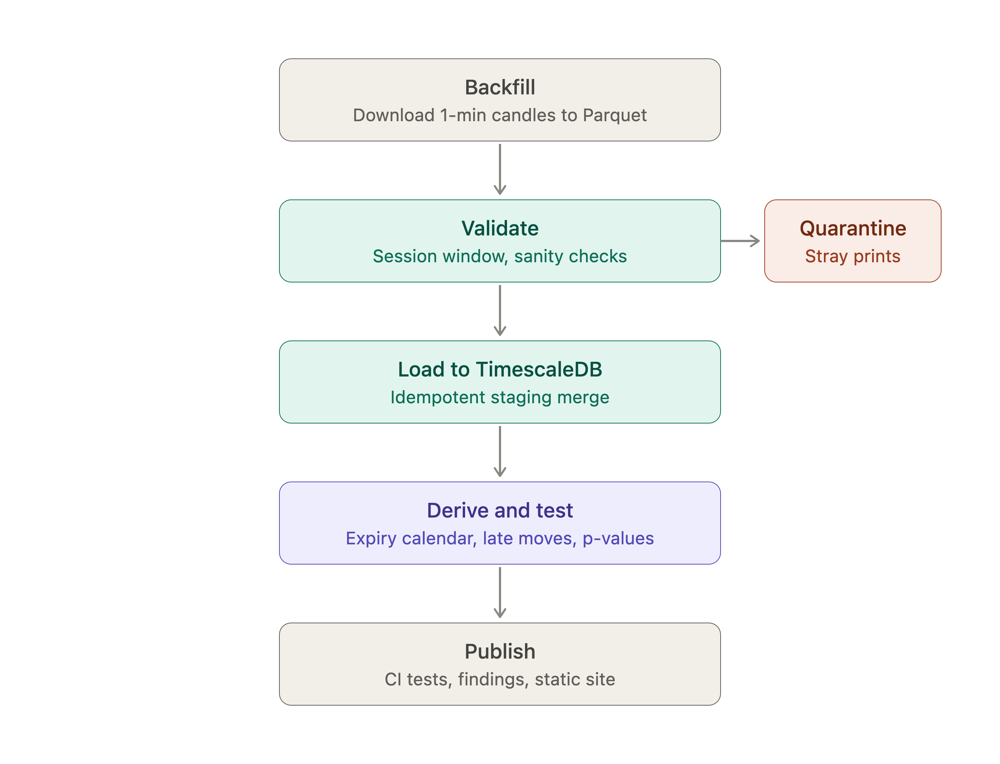

# ExpiryLens

Studying how India's index expiry-day settlement can be pushed around, and
how much it costs to move it, using only public market data.

Status: early days. Setting up the environment and data pipelines.

## Why this exists

SEBI's 2025 and 2026 orders on expiry-day trading showed how much money rides
on the last few minutes of an expiry. ExpiryLens tries to measure those
footprints openly, and to check how well that measurement actually works.

## Repo layout

- `pipelines/` data ingestion and validation
- `api/` backend
- `web/` dashboard
- `research/` notebooks and experiments
- `docs/` methodology and images

More soon.

## Architecture

## Daily workflow

